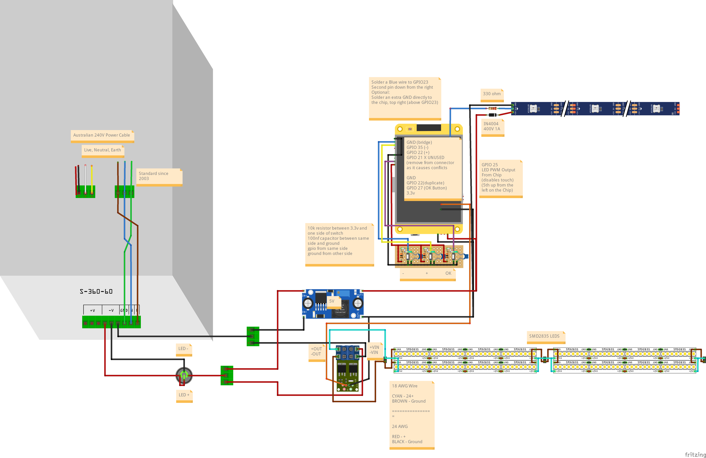
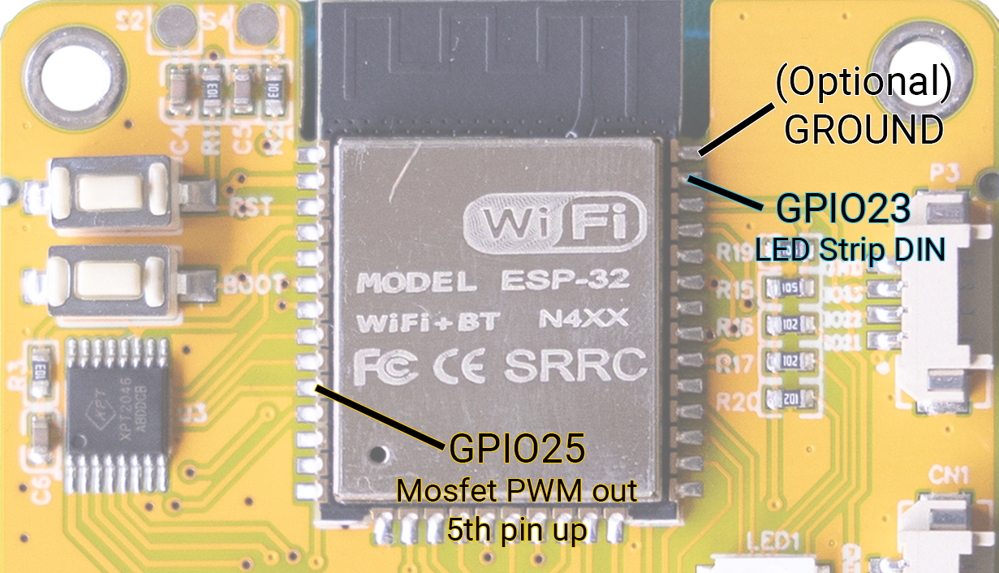
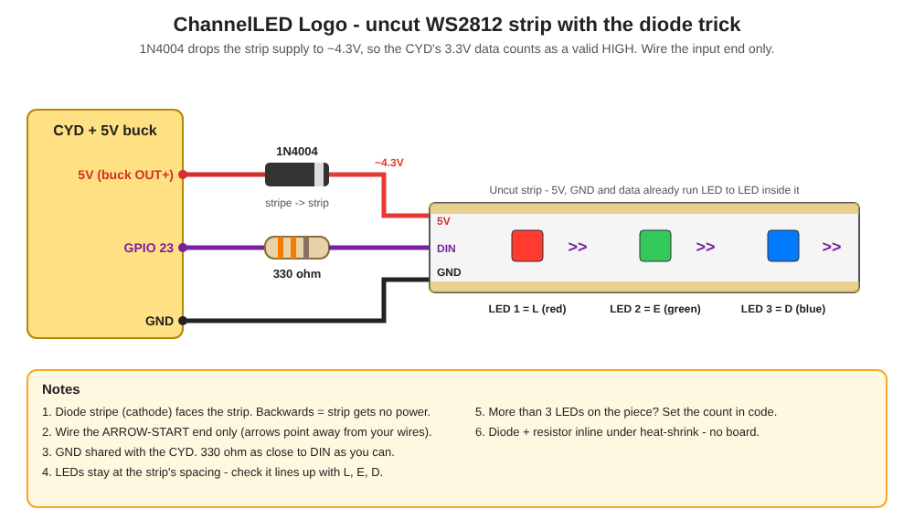

# ChannelLED

**ChannelLED** is an ESP32 light controller for custom LED battens, built on the **Cheap Yellow Display** (ESP32-2432S028R).

Three physical buttons and a glowing on-screen menu control the brightness, animation and speed of the lights. Several lights can be linked wirelessly over **ESP-NOW**: set one and the rest follow. No Wi-Fi network or router is needed.

---

## What it does

- **Dims LED battens** smoothly from 0–100% using 20kHz PWM through a dual-MOSFET module (above hearing range, so no whine)
- **Runs animations:** None, Blink, Strobe, Chase, Lightning Clone, Lightning Chase and Lightning Random. The Speed slider is a ramp tuned per animation.
- **Links multiple lights** wirelessly:
  - **Host:** leads the group. Only one per group.
  - **Client:** follows the Host and reconnects automatically if it drops out.
  - **Standalone:** runs on its own.
- **Sets itself up at power-on:** joins a Host if it hears one, otherwise becomes the Host. Press Enter to skip and run Standalone.
- **Shows each mode in its own colour theme:** Host is blue, Client is green, Standalone is orange.
- **Lights the case logo** (L / E / D in red, green, blue) with Off, Steady or Breathe, synced from the Host
- **Button shortcuts** for 50% brightness, all off and the Config menu
- **Screen sleeps** after 60s of no input. The lights keep running.

---

## Hardware

- Cheap Yellow Display (ESP32-2432S028R)
- 24V 2835 SMD 240 LED/m strip, 6000K, IP20
- 6A 220V PSU
- High-power dual MOSFET switch: two parallel N-channel, logic-level MOSFETs with low R<sub>DS(on)</sub>. I'm using one labelled **XY-MOS**.
- 24V to 5V step-down module (powers the CYD and the logo LEDs)
- 3 × momentary push buttons
- 3 × 10kΩ resistors (pull-ups)
- 3 × 100nF ceramic capacitors (button debounce)
- Illuminated power switch. The LED insert must be the **12–24V** version - a 220V insert barely glows on 24V.
- **Case logo (optional):**
  - WS2812B addressable 5050 RGB strip, 144 LEDs/m - a 3-LED piece (uncut)
  - 1 × 1N4004 diode (the "diode trick" - see Wiring)
  - 1 × 330Ω resistor (data line)

### LEDs per light

SMD 240 LED/m @ 24V:

- 22 LEDs per row
- 2 rows per batten = **44 LEDs per batten**
- 6 battens per light
- **Grand total: 264 LEDs per completed light**

I have two lights, but the maximum is **264 LEDs per PSU**.

---

## Wiring



| Function | GPIO | Notes |
|---|---|---|
| LEFT (–) button | 35 | Input only. Needs the external 10k pull-up. |
| RIGHT (+) button | 22 | 10k pull-up + 100nF |
| OK / Enter button | 27 | 10k pull-up + 100nF |

### Solder points on the ESP32 module

These pins aren't on any header, so they're soldered straight to the ESP32-WROOM-32 module:



| Function | GPIO | Notes |
|---|---|---|
| LED PWM out → MOSFET TRIG/PWM | 25 | **Solder directly to the ESP32 module.** It's the 5th pin up from the bottom-left corner. |
| Case logo LEDs (data in) | 23 | Optional. **Solder directly to the ESP32 module** - the pin directly below GND (2nd from the top, right side). It's also the SD card's data line, so keep the SD slot empty. |
| Ground | GND | **Optional.** Top-right pin, next to the antenna shield. Same ground as the CYD's power input - only useful as a thicker ground wire. |

> ⚠️ **GPIO 21 is tied to the LCD backlight.** Don't use it for anything else.
> None of the button pins are boot-strapping pins, so holding a button at power-on won't stop the board booting.

### Case logo LEDs (the diode trick)

The ESP32 sends 3.3V data, which is too low for WS2812 LEDs running on a full 5V. A 1N4004 in the LEDs' 5V feed drops their supply to about 4.3V, so 3.3V counts as a valid HIGH - no level shifter needed.



1. **5V (buck OUT+) → 1N4004** (stripe towards the strip) **→ strip 5V**
2. **GND → strip GND** - take it straight from the buck / GND bus, shared with the CYD
3. **GPIO 23 → 330Ω → strip DIN**, at the arrow-start end of the strip

---

## Software Setup

1. Install the **Arduino IDE** and the **ESP32 Arduino core v3.x**: Boards Manager → *esp32 by Espressif*. The sketch uses `ledcAttach()` and the v3 ESP-NOW callback.
2. Select the board: **ESP32 Dev Module**.
3. Install these libraries from the Library Manager:
   - **TFT_eSPI** (by Bodmer)
   - **FastLED** (3.9 or newer, for ESP32 core v3) - required, drives the case logo LEDs
4. **Set up TFT_eSPI for the CYD with the `User_Setup.h` in this repo:**
   1. Find the TFT_eSPI library folder:
      - **Windows:** `Documents\Arduino\libraries\TFT_eSPI\`
      - **macOS / Linux:** `~/Arduino/libraries/TFT_eSPI/`
   2. Rename the existing `User_Setup.h` there to `User_Setup.h.bak`, as a backup.
   3. Copy `User_Setup.h` from this repo into that folder.
   4. Restart the Arduino IDE.

   > ⚠️ Updating TFT_eSPI through the Library Manager **overwrites `User_Setup.h`**. After any library update, copy this repo's file in again.

   <details>
   <summary>Key settings in the provided User_Setup.h</summary>

   ```cpp
   #define ST7789_DRIVER
   #define TFT_RGB_ORDER TFT_BGR
   #define TFT_INVERSION_OFF
   #define TFT_BL   21
   #define TFT_BACKLIGHT_ON HIGH
   #define TFT_MISO 12
   #define TFT_MOSI 13
   #define TFT_SCLK 14
   #define TFT_CS   15
   #define TFT_DC    2
   #define TFT_RST  -1
   #define LOAD_GLCD
   #define LOAD_FONT2
   #define LOAD_GFXFF      // Required - bold logo font
   #define SMOOTH_FONT
   #define SPI_FREQUENCY 55000000
   #define USE_HSPI_PORT
   ```
   </details>

5. **Give every unit a unique number** before flashing it. Edit near the top of the sketch:
   ```cpp
   #define DEVICE_GROUP_NAME  "ConnectLED"   // Same on every unit in the group
   #define DEVICE_NUMBER      "01"           // UNIQUE per unit: 01, 02, 03 ...
   ```
6. Open `ChannelLED.ino`, connect the CYD over USB and click **Upload**.
7. **Flash every unit with the same version.** The units decode each other's messages directly, so mixed versions won't sync.

You may see this compiler warning. It's safe to ignore because the CYD's touch screen isn't used:
```
TOUCH_CS pin not defined, TFT_eSPI touch functions will not be available!
```

---

## Controls

| Button | Action |
|---|---|
| **–** / **+** | Move between items, or change a value while editing |
| **OK** (press) | Start or confirm editing the highlighted item |

### Button Shortcuts (Hold)

| Shortcut | Buttons |
|---|---|
| 50% Brightness (no animation) | Hold **–** & **+** for 1s, then release |
| All Off | Hold **–** & **+** & **OK** for 1s |
| Config menu | Hold **OK** for 1s, then release (same again to cancel) |
| Start at 50% brightness | Hold **–** while powering on |
| Skip the Host search | Press **OK** on the boot screen (runs Standalone) |

### Config menu (hold OK)

Works the same way as the main menu:

1. **Mode** is highlighted when it opens.
2. **–** / **+** moves the highlight: **Mode → Logo → Update → Cancel**.
3. **OK** on Mode or Logo starts editing it - **–** / **+** changes the value, **OK** confirms.
   - **Mode:** Host / Client / Standalone. Leave it on the current mode for no change.
   - **Logo:** Off / Steady / Breathe. Locked on a Client (it follows the Host).
4. **OK** on **Update** applies. **OK** on **Cancel** (or holding **OK**) closes with nothing changed.

> **Client mode is view-only.** The menu shows the Host's Brightness, Animation and Speed in compact rows with no sliders. The info box stays on one page: *Controlled by Host*, the **Config Menu** shortcut (hold **OK**) and the Key. **–**, **+** and the 50% Brightness / All Off shortcuts do nothing. To control a unit on its own, switch it to Standalone.

---

## Modes

| Mode | Name | Behaviour |
|---|---|---|
| **H** Host | `H_ConnectLED` | Leads the group and sends its settings (including the logo mode) to every Client |
| **C** Client | `C_ConnectLED_<num>` | Follows the Host and reconnects automatically. Controls are view-only. |
| **S** Standalone | `SA_ConnectLED_<num>` | Ignores the group |

- On power-on the unit searches for a Host for 10 seconds:
  - If it hears a Host, it becomes a **Client**.
  - If it hears none, it becomes the **Host**.
- The mode is **not saved**. Every power-on searches again.
- **Changing mode** (Config menu):
  - Becoming a Host is refused if a Host already exists.
  - Becoming a Client with no Host around offers to make this unit the Host instead.
- If two Hosts ever hear each other, the one with the lower MAC address stays Host.

### Status icons (top-right)

| Icon | Meaning |
|---|---|
| 🟢 Chain | Connected |
| 🟡 Broken chain (blinking) | Retrying. The Client is looking for its Host. |
| House | Host |
| Linked node | Client |
| Person | Standalone (no link icon) |

---

## Animations

The **Speed** slider is a ramp: far left is the slowest, far right is the fastest. Each animation has its own range.

| Animation | Description | Speed controls | Slowest → Fastest |
|---|---|---|---|
| None | Steady light at the set brightness | - | - |
| Blink | On / off | Time on and off | 2s → 0.1s |
| Strobe | Fast on / off | Time on and off | 250ms → 20ms |
| Chase | Each linked unit fades 0 → 50% → 0 in turn: the Host first, then the Clients in name order | Pulse length | 3s → 0.3s |
| Lightning Clone | The Host makes a strike and every light plays the identical strike at the same time | Gap between strikes | 30s → 1s |
| Lightning Chase | The Host strikes, then Client 1, then Client 2 ... each with its own random strike | Delay between lights | 3s → 0.2s |
| Lightning Random | A random light (Host or any Client) strikes after each gap | Gap between strikes | 20s → 0.5s |

Every lightning strike is randomised: 2–8 flashes, each at 20–100% of the Brightness setting, with random 20–120ms flicker timing and ±50% on the gap. On a Standalone unit the three lightning animations all strike on that unit alone.

---

## Customising

### Speed ramp and lightning

In the `VARIABLES` section of the sketch:

```cpp
// Speed 1 (far left) = slowMs ... Speed 100 (far right) = fastMs, per animation
const SpeedRamp SPEED_RAMP[ANIM_COUNT] = {
  {     0,    0 },   // NONE
  {  2000,  100 },   // BLINK
  {   250,   20 },   // STROBE
  {  3000,  300 },   // CHASE
  { 30000, 1000 },   // LIGHTNING_CLONE
  {  3000,  200 },   // LIGHTNING_CHASE
  { 20000,  500 }    // LIGHTNING_RANDOM
};

const int LIGHTNING_FLASHES_MIN    = 2;    // Flashes per strike
const int LIGHTNING_FLASHES_MAX    = 8;
const int LIGHTNING_INTENSITY_MIN  = 20;   // % of the Brightness setting
const int LIGHTNING_INTENSITY_MAX  = 100;
const int LIGHTNING_FLICKER_MIN_MS = 20;
const int LIGHTNING_FLICKER_MAX_MS = 120;
const int LIGHTNING_GAP_JITTER_PCT = 50;   // +/- random wobble on the gap
```

### Batten PWM frequency

```cpp
#define PWM_FREQ  20000  // 20kHz - above hearing range. 5kHz makes the battens whine. XY-MOS is rated up to 20kHz.
```

After changing it, check the XY-MOS after a few minutes at about 50% - warm is fine, too hot to touch means drop to 15000.

### Look

Each mode has its own theme in the `VARIABLES` section of the sketch:

```cpp
// { background, backgroundIntensity 0-100, glow, glowIntensity 0-100 }
UiTheme hostTheme       = { 0x08EB, 60, 0x05BF, 40 };  // Blue / cyan
UiTheme clientTheme     = { 0x09C4, 60, 0x07EF, 40 };  // Green
UiTheme standaloneTheme = { 0x38E0, 60, 0xFC60, 40 };  // Orange
```

- **background:** screen background colour (RGB565)
- **backgroundIntensity:** 0 is black, 100 is the background colour at full strength
- **glow:** colour of the frames, highlights and icons
- **glowIntensity:** 0 is no glow, 100 is the strongest glow

### Case logo backlight

Three addressable LEDs light the L, E and D on the case in fixed colours - red, green and blue, matching the on-screen logo. Off / Steady / Breathe is set in the Config menu and copied from the Host to every Client. The logo keeps running while the screen sleeps and isn't touched by the batten brightness or All Off.

```cpp
// DEFINES
#define LOGO_LED_PIN       23
#define LOGO_LED_COUNT     3        // Set to match if your strip piece has more
#define LOGO_LED_CHIPSET   WS2812B  // e.g. SK6812 for a different LED type
#define LOGO_COLOR_ORDER   GRB      // Try RGB if red and green come out swapped

// VARIABLES
LogoMode logoMode = LOGO_BREATHE;                  // Power-on default: LOGO_OFF / LOGO_STEADY / LOGO_BREATHE
const uint8_t LOGO_STEADY_PERCENT          = 60;   // Steady brightness
const uint8_t LOGO_BREATHE_MIN_PERCENT     = 5;    // Bottom of each breath
const uint8_t LOGO_BREATHE_MAX_PERCENT     = 100;  // Top of each breath
const unsigned long LOGO_BREATHE_PERIOD_MS = 4000; // One full breath, in and out
const uint32_t LOGO_COLOURS[LOGO_LED_COUNT] = { 0xFF0000, 0x00FF00, 0x0000FF }; // L red, E green, D blue
```

If a logo setting is invalid (e.g. a 0 breathe period), the sketch prints an error log to the Serial Monitor and turns the logo off - the battens, display and sync keep running.

### Text colours

Text colours are set in `DEFINES`:

- `MENU_COL_TEXT`: titles (white)
- `MENU_COL_BODY`: everything else (grey)

The boot screen always uses the Host theme.

### Themes

| Host | Client | Standalone |
|---|---|---|
|  |  |  |

### Screens

| Boot | Key | Editing |
|---|---|---|
|  |  |  |

| Config Menu | Mode Updated | Client Retrying |
|---|---|---|
|  |  |  |

---

## Disclaimer for AI use

Parts of this code were written with the help of Claude Code. I've tested it and run it on my own hardware, but as with any code, results may vary. Review it before you run it. I'm not accountable for any damage or issues arising from its use.

**2026 Disaster of Puppets** — have fun :)
